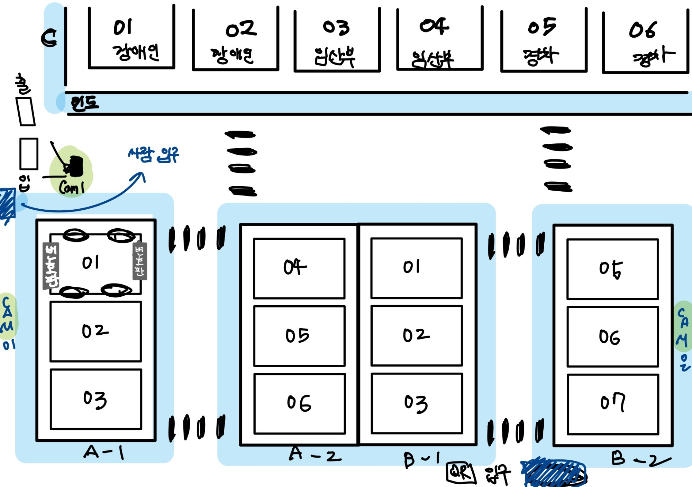
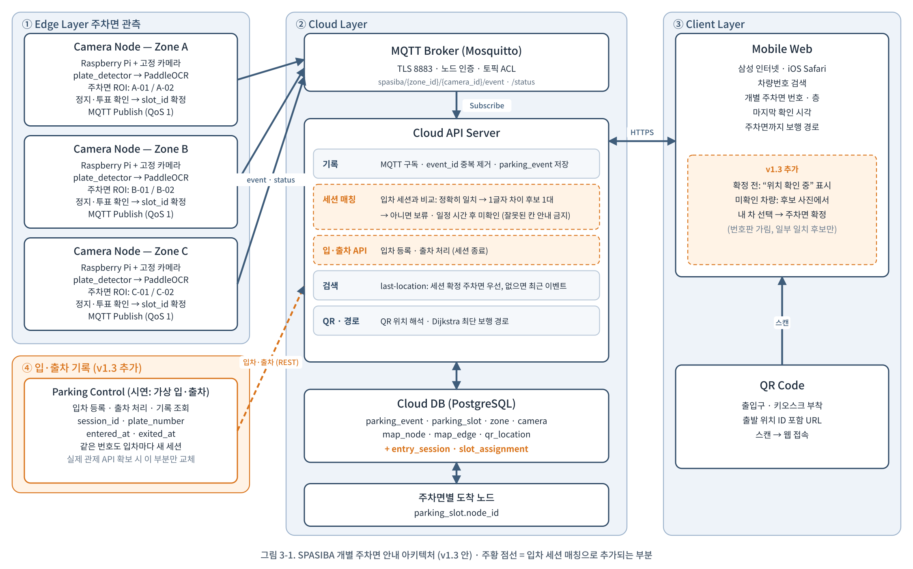

# SPASIBA 프로젝트 개요

> 작성: 2026-11-18 (팀 회의 내용 반영, 배치는 회의 정리본 기준) · 정리: 수꽝
> 기준 문서: 소프트웨어 아키텍처 명세서(SAD) v1.2, 서버 인터페이스 명세 v0.4(`docs/server_interface.md`)
> 그림이나 배치가 바뀌면 이 문서를 고치고, 인터페이스에 영향이 있으면 `server_interface.md`를 먼저 고친다.

---

## 1. 한 줄 요약

**주차한 차가 어디 있는지 몰라 헤매지 않게, 사람이 들어오는 입구에서 QR을 찍으면 내 차까지 가는 길을 휴대폰에 보여 주는 실내 주차장 서비스.**

- 입구 카메라가 들어오는 차의 번호를 읽어 **입차 기록**을 남긴다.
- 주차 구역 카메라(Raspberry Pi)가 **"이 칸에 이 번호"** 를 서버에 보낸다.
- 서버가 둘을 **매칭**해 차의 칸을 확정한다 (번호를 한 글자 잘못 읽어도 입차 기록으로 바로잡음).
- 사용자가 입구의 **QR이나 키오스크**에서 차량번호를 입력하면, 그 입구에서 차까지의 **보행 경로**를 웹으로 보여 준다.

---

## 2. 서비스 흐름

```
① 입차          입구 카메라가 번호 인식 → 입차 기록 (entry_session)
② 주차          구역 카메라(Pi)가 칸 + 번호 인식 → MQTT 이벤트
③ 칸 확정       서버가 입차 기록과 매칭 → 차의 칸 확정 (못 맞추면 관리자 확인)
④ 길 찾기       사용자가 사람용 입구에서 QR/키오스크 → 차량번호 입력
                 → 서버가 칸 조회 → 그 입구에서 칸까지 최단 보행 경로 표시
⑤ 출차          출구에서 출차 기록 → 이후 조회는 "기록 없음"
```

| 입구 장치 | 사용 시점 | 동작 |
|---|---|---|
| **키오스크** | 나갈 때 | 주차 요금 **결제 후** 내 차까지 경로 표시 |
| **QR** | 어디 다녀와서 차로 돌아갈 때 | 결제 없이 **경로만** 표시 (QR 위치 = 출발점) |

- QR은 **출발 위치**를 알려 주고(`location_id`), 차량번호는 **도착 칸**을 찾는 기준이다.
- 입차 기록만으로는 칸을 알 수 없으므로 ②·③의 칸 인식과 매칭이 필요하다.

---

## 3. 주차장 배치 (2026-11-18 회의)

### 3.1 배치도 (회의 정리본)



회의 중 손그림은 [figures/meeting_2026-11-18_parking_layout.webp](figures/meeting_2026-11-18_parking_layout.webp)에 있습니다.

### 3.2 구역과 칸 (총 18칸)

| 구역 | 블록 | 칸 | 비고 |
|---|---|---|---|
| **C** | 맨 위 한 줄 | 01·02 **장애인**, 03·04 **임산부**, 05·06 **경차** | 바로 아래 가로 인도 |
| **A** | A-1 (왼쪽 블록) | 01, 02, 03 | 왼쪽 벽 쪽에 CAM 01 |
| **A** | A-2 (가운데 블록 왼쪽) | 04, 05, 06 | B-1과 등을 맞댐 |
| **B** | B-1 (가운데 블록 오른쪽) | 01, 02, 03 | |
| **B** | B-2 (오른쪽 블록) | 05, 06, 07 | 04가 빠져 있음 (3.4 확인) · 오른쪽 벽 쪽에 CAM 02 |

- 세로 순서: **A-1 – 도로 – A-2 | B-1 – 도로 – B-2**
- **차 방향:** 세로 블록의 차는 가로로 서고, **앞뒤 번호판이 양쪽 도로(또는 벽)를 향합니다** (A-1 01번 칸 그림).

### 3.3 출입구·보행로

| 요소 | 위치 |
|---|---|
| 차량 출구·입구 | **왼쪽**. 위가 출구(출), 아래가 입구(입). 입구에 **입차 카메라 Cam1** |
| 사람 입구 | 왼쪽 차량 입구 옆 (화살표로 주차장 안으로) |
| QR 입구 | **아래쪽 B-1과 B-2 사이**. 위층에서 내려오는 입구 |
| 인도 | C구역 아래 가로 인도, 왼쪽 벽을 따라 세로 인도, 블록마다 둘레 |
| 횡단보도 | 위쪽 인도 → 블록으로 내려오는 곳 2개, 세로 도로마다 위·아래 2개씩 (4개) |

### 3.4 확인이 필요한 부분

- [ ] B-2 칸 번호가 **05·06·07**인데 B-1이 01~03이라 **04가 빠져 있음** → 04·05·06이 맞는지
- [ ] 칸 ID 표기: 인터페이스 형식(`{zone_id}-{번호2자리}`)에 맞추면 `B2-A-01`~`06`, `B2-B-01`~`06`, `B2-C-01`~`06`. A-1·A-2 같은 블록 이름은 지도 표시용 이름(`name`)으로만 쓸지 → 수빈과 확정
- [ ] **키오스크** 위치 (정리본에는 QR 입구만 있음)
- [ ] 출구에도 카메라가 필요한지 (지금은 입구 Cam1만. 출차는 출차 기록 API로 처리)
- [ ] 입차 카메라 Cam1이 서버에 입차를 알리는 방법 (지금 서버에는 `POST /entries`만 있음 → Cam1 쪽 프로그램이 이 API를 부를지)
- [ ] 수빈의 지도 데이터(`map/b2.json`)를 이 배치(18칸, 구역 3개, 인도·횡단보도)로 다시 작성

---

## 4. 카메라 배치

### 4.1 정리본 기준

| 카메라 | 위치 | 보는 칸 | `camera_id` (v0.4 형식 제안) |
|---|---|---|---|
| Cam1 | 왼쪽 차량 입구 | 들어오는 차 (입차 기록) | 칸 이벤트를 보내지 않음 |
| CAM 01 | **왼쪽 벽**, A-1 옆 | A구역 (A-1, A-2) | `CAM-B2-01` |
| CAM 02 | **오른쪽 벽**, B-2 옆 | B구역 (B-1, B-2) | `CAM-B2-02` |
| C구역 | 미정 | C-01~06 | 미정 |

**CAM 01·02도 한 가지 확인이 필요합니다.** A-1 차의 왼쪽 번호판은 CAM 01을 정면으로 보지만, **A-2 차의 번호판은 A-1과 A-2 사이 도로 쪽**을 봅니다. 왼쪽 벽에서 보면 A-2 번호판은 A-1 차들 너머에 있어 가려지거나 비스듬하게 찍힐 수 있습니다. B-1과 CAM 02도 같습니다. 카메라를 높이 달아 내려다보게 하면 해결될 수도 있으니, 모형에서 한 장 찍어 확인해 주세요.

### 4.2 C구역을 어떻게 볼까: "아래 카메라 화면 일부를 잘라서 돌려 OCR" 제안에 대한 의견

**결론: 정리본 배치에서는 어려울 가능성이 큽니다. C구역 전용 카메라 1대를 추천하고, 그 전에 사진 한 장으로 확인해 보는 순서를 제안합니다.**

**어려운 이유**
- C구역 번호판은 **아래쪽(인도·도로 쪽)** 을 봅니다. 그런데 CAM 01·02는 **왼쪽·오른쪽 벽**에서 가로 방향으로 봅니다. 그러면 C 번호판은 거의 **옆모습**으로 찍힙니다. 특히 CAM 01에서 먼 C-04~06, CAM 02에서 먼 C-01~03이 그렇습니다.
- 화면을 잘라 **돌리거나 원근 보정**을 해도, 옆에서 본 번호판은 글자 폭이 몇 픽셀밖에 안 남아 펴지지 않습니다. 잘라내기는 픽셀을 늘리지 않습니다 (Pi 팀 기록: 실제 캡처 1280×720, 먼 번호판은 픽셀 부족).
- 세로 블록의 차와 도로를 지나는 차가 C 쪽 시야를 가릴 수 있습니다.

**소프트웨어 쪽은 어느 방법이든 준비돼 있습니다**
- Pi 코드는 카메라 한 대에 여러 칸을 ROI로 나눠 맡길 수 있고(`rois`), 인터페이스 v0.4에서 카메라를 구역에서 떼어 냈기 때문에 어느 카메라가 C칸을 맡아도 서버는 바꿀 것이 없습니다. 지도 데이터에서 C칸의 `camera_id`만 그 카메라로 등록하면 됩니다.

**제안 순서**
1. **(비용 0) 사진 한 장:** 모형에서 CAM 01 자리에 카메라를 두고 C-01(가장 가까운 칸)에 번호판 모형을 세워 찍어 봅니다. 가장 가까운 칸도 안 읽히면 이 방법은 접습니다.
2. **C 전용 카메라 1대 (추천):** 가운데 블록(A-2·B-1) **위쪽 끝**이나 위쪽 횡단보도 근처에서 **위(C구역)를 바라보게** 두면 6칸 번호판을 거의 정면으로 봅니다. 한 대에 6칸이 다 안 들어오면 3칸씩 2대입니다. 카메라는 Cam1 + CAM 01·02 + C용 1대로 총 4대가 됩니다.
3. 사진 테스트에서 가까운 칸(C-01~02, C-05~06)만 읽히면, 양쪽 벽 카메라가 가까운 칸을 나눠 맡고 가운데 C-03~04만 전용 카메라로 보는 절충도 가능합니다.

> 판단 기준(번호판이 몇 픽셀이면 충분한지)은 Pi 팀의 OCR 실험 결과로 정하는 게 정확합니다.

---

## 5. 시스템 구성과 담당



| 파트 | 담당 | 하는 일 | 상태 (11/18) |
|---|---|---|---|
| AI·IoT (Pi) | AI·IoT 파트 | 카메라 → YOLO 번호판 검출 → PaddleOCR → 여러 프레임 투표 → 칸 판단 → MQTT 발행, 장애 시 재전송 | OCR 완료, MQTT 연동 코드 있음 (`raspberrypi` 브랜치). 정차·빈 칸 판단 미구현 |
| 서버: 수신·DB·매칭 | 수꽝 | MQTT 수신, 입·출차 기록, 매칭, 차량 조회 API, 관리자 확인 | 작업 4~8·10 완료 (`server/matching` 브랜치) |
| 서버: 지도·경로 | 수빈 | 지도 데이터, QR 해석, 최단 경로(Dijkstra), 지도 API, 3D 시뮬레이터 | `server/matching`에 합침, 관리자 API 추가. 지도는 샘플 |
| Web | Web 파트 | QR 접속 화면, 차량번호 검색, 지도 위 경로 표시 | - |
| 클라우드 | 공동 | Azure for Students (VM B1s + PostgreSQL B1MS) | 배포 전 |

**주고받는 것 (인터페이스 v0.4 요약)**
- Pi → 서버 (MQTT): `spasiba/{camera_id}/event` = `{event_id, plate_number, camera_id, slot_id, recognized_at, votes, frames}`
- 서버 → 웹 (REST): `GET /vehicles/{번호}/last-location` → 칸·층·도착 노드 (`CONFIRMED` / `PENDING` / 404)
- 웹 → 서버 (REST): `GET /qr/{QR id}` → 출발 노드, `GET /route?from={QR id}&to={칸}` → 경로

---

## 6. 정할 것과 다음 할 일

**이번 회의 배치 관련**
- [ ] 3.4의 확인 필요 항목 확정 → 수빈이 지도 데이터를 새 배치(18칸)로 다시 작성
- [ ] CAM 01·02로 안쪽 블록(A-2, B-1)까지 보이는지 사진 확인 (4.1)
- [ ] C구역 카메라: 사진 한 장 테스트 후 전용 카메라 여부 결정 (4.2)
- [ ] 키오스크(결제 + 경로)와 QR(경로만)의 위치·개수, 결제 화면을 어느 파트가 만들지
- [ ] 입차 카메라 Cam1과 서버 연결 방법

**기존 상의 안건** (`docs/team_agenda_pi_server.md`)
- [ ] Pi 이벤트 발행 조건과 빈 칸 판단 (`publish_on_consensus`)
- [ ] crop 사진 요청·응답 조건
- [ ] 칸 목록을 Pi와 지도 데이터 중 어디를 원본으로 둘지
- [ ] 새 카메라 ID 형식(`CAM-B2-01`)을 지도 데이터에 반영
