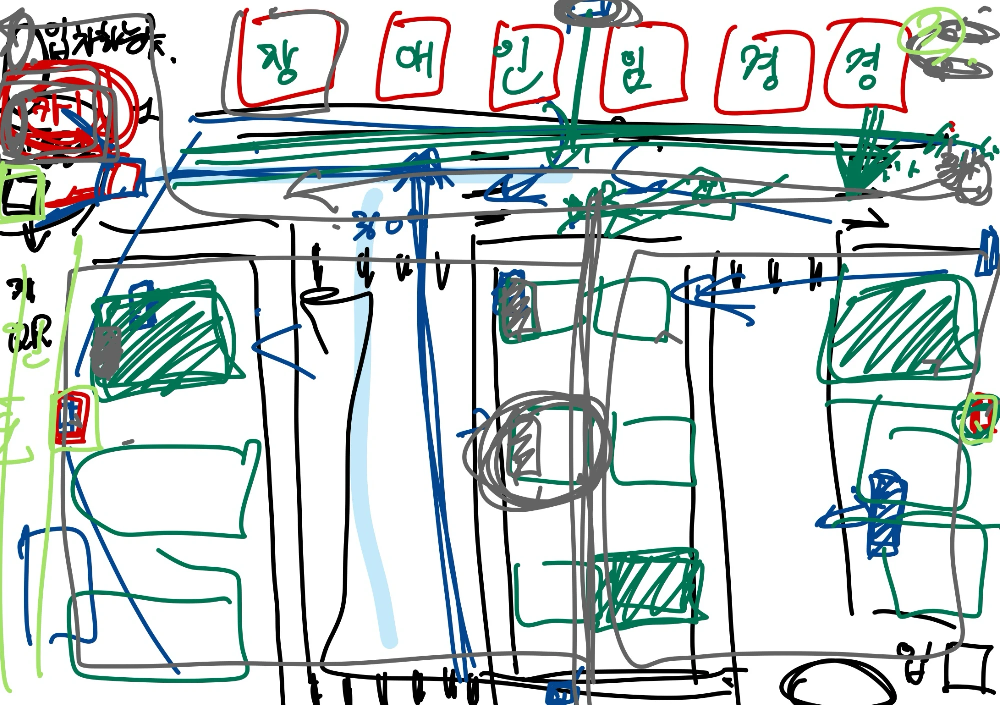

# SPASIBA 프로젝트 개요

> 작성: 2026-11-18 (팀 회의 내용 반영) · 정리: 수꽝
> 기준 문서: 소프트웨어 아키텍처 명세서(SAD) v1.2, 서버 인터페이스 명세 v0.4(`docs/server_interface.md`)
> 그림이나 배치가 바뀌면 이 문서를 고치고, 인터페이스에 영향이 있으면 `server_interface.md`를 먼저 고친다.

---

## 1. 한 줄 요약

**주차한 차가 어디 있는지 몰라 헤매지 않게, 사람이 들어오는 입구에서 QR을 찍으면 내 차까지 가는 길을 휴대폰에 보여 주는 실내 주차장 서비스.**

- 입구 카메라가 들어오는 차의 번호를 읽어 **입차 기록**을 남긴다.
- 주차 구역 카메라(Raspberry Pi)가 **"이 칸에 이 번호"** 를 서버에 보낸다.
- 서버가 둘을 **매칭**해 차의 칸을 확정한다 (번호를 한 글자 잘못 읽어도 입차 기록으로 바로잡음).
- 사용자가 입구의 **QR이나 키오스크**에서 차량번호를 입력하면, 그 입구에서 차까지의 **보행 경로**를 웹으로 보여 준다.

---

## 2. 서비스 흐름

```
① 입차          입구 카메라가 번호 인식 → 입차 기록 (entry_session)
② 주차          구역 카메라(Pi)가 칸 + 번호 인식 → MQTT 이벤트
③ 칸 확정       서버가 입차 기록과 매칭 → 차의 칸 확정 (못 맞추면 관리자 확인)
④ 길 찾기       사용자가 사람용 입구에서 QR/키오스크 → 차량번호 입력
                 → 서버가 칸 조회 → 그 입구에서 칸까지 최단 보행 경로 표시
⑤ 출차          출구에서 출차 기록 → 이후 조회는 "기록 없음"
```

| 입구 장치 | 사용 시점 | 동작 |
|---|---|---|
| **키오스크** | 나갈 때 | 주차 요금 **결제 후** 내 차까지 경로 표시 |
| **QR** | 어디 다녀와서 차로 돌아갈 때 | 결제 없이 **경로만** 표시 (QR 위치 = 출발점) |

- QR은 **출발 위치**를 알려 주고(`location_id`), 차량번호는 **도착 칸**을 찾는 기준이다.
- 입차 기록만으로는 칸을 알 수 없으므로 ②·③의 칸 인식과 매칭이 필요하다.

---

## 3. 주차장 배치 (2026-11-18 회의)

### 3.1 회의 그림



### 3.2 정리한 배치도

```
 ┌─────────────────────────────────────────────────────────────────────┐
 │ [입·출차 🚗]   C구역(맨 위, 가로로 6칸)                              │
 │  📷 입차 OCR    [장][애][인][임][경][경]                             │
 │ [🚶 QR/키오스크] ════════════ 가로 도로 ════════════════════════     │
 │                  ┊횡단보도┊                ┊횡단보도┊                 │
 │  인도 ┃1줄┃  세로   ┃2줄┃3줄┃  세로   ┃4줄┃ 인도                    │
 │       ┃   ┃  도로   ┃   ┃   ┃  도로   ┃   ┃                         │
 │       ┃   ┃         ┃   ┃   ┃         ┃   ┃                         │
 │                  ┊횡단보도┊                ┊횡단보도┊                 │
 │                                              [🚶 위층에서 내려오는 입구]│
 │                                              [   QR/키오스크        ]│
 └─────────────────────────────────────────────────────────────────────┘
```

| 요소 | 내용 |
|---|---|
| 입·출차 | **왼쪽 위**. 들어오는 차를 확인하는 **입차 OCR 카메라 1대** |
| C구역 | **맨 위 가로 한 줄 6칸**. 그림의 글자는 `장·애·인·임·경·경` (장애인·임산부·경차 전용 칸으로 보임, 확인 필요) |
| 가로 도로 | C구역 아래, 왼쪽 입구에서 오른쪽 끝까지 |
| 세로 주차 줄 | 4줄: **1줄 – 도로 – 2줄 · 3줄 – 도로 – 4줄** (2줄과 3줄은 등을 맞댐) |
| 인도 | 주차 구역 **테두리**를 따라 있음 |
| 횡단보도 | 세로 도로마다 **위·아래 끝**에 있음 (인도끼리 연결) |
| 사람용 입구 | 왼쪽(입·출차 옆)과 **오른쪽 아래(위층에서 내려오는 입구)**. 입구마다 **QR 또는 키오스크** |

### 3.3 확인이 필요한 부분 (그림만으로 확실하지 않음)

- [ ] C구역 6칸의 용도: `장애인 / 임산부 / 경차`가 각각 몇 칸인지
- [ ] C구역은 **전면 주차**(벽 쪽으로 머리)인지 **후면 주차**인지 → 번호판이 도로 쪽을 보는지 결정 (4장 C구역 카메라와 연결)
- [ ] 세로 4줄 중 어디가 **A구역**, 어디가 **B구역**인지 (예: 왼쪽 도로를 보는 카메라 = A, 오른쪽 = B?)
- [ ] 줄마다 칸 수 (그림에서는 줄당 2~3칸)
- [ ] 사람용 입구와 QR·키오스크의 정확한 위치와 개수
- [ ] 지도 데이터(수빈의 `map/b2.json`)는 지금 **구역 2개(A·B), 칸 8개** 샘플 → 이 배치로 다시 그려야 함

---

## 4. 카메라 배치

### 4.1 현재 계획

| 카메라 | 보는 곳 | 하는 일 |
|---|---|---|
| 입차용 1대 | 왼쪽 위 입·출차 | 들어오는 차 번호 → 입차 기록 |
| A구역용 1대 | 세로 줄 일부 | 칸별 번호 인식 → MQTT 이벤트 |
| B구역용 1대 | 세로 줄 일부 | 〃 |
| **C구역** | 맨 위 6칸 | **미정** ← 이번 회의 고민 |

### 4.2 C구역을 어떻게 볼까: "아래 카메라 화면 일부를 잘라서 돌려 OCR" 제안에 대한 의견

**결론: 해 볼 만한 방법입니다. 다만 "돌리기(회전)"가 아니라 "원근 보정"이 필요하고, 실제 카메라 위치에서 사진 한 장으로 먼저 확인한 뒤 정하는 게 좋습니다.**

**되는 이유 (소프트웨어 쪽은 이미 준비됨)**
- Pi 코드는 이미 **카메라 한 대에 여러 칸**을 ROI(칸별 영역 다각형)로 나눠 배정할 수 있습니다 (`rois` 설정).
- 서버 인터페이스 v0.4에서 **카메라를 구역에서 떼어 냈기 때문에**, A구역 카메라가 C구역 칸 이벤트를 보내도 됩니다. 서버는 바꿀 것이 없고, 지도 데이터에 그 칸의 `camera_id`만 그 카메라로 등록하면 됩니다.
- 카메라를 늘리지 않으니 비용·배선·Pi 대수가 그대로입니다.

**걱정되는 점 3가지**

| 문제 | 설명 | 대응 |
|---|---|---|
| ① 해상도 | 화면을 잘라내도 **픽셀은 늘어나지 않습니다.** C구역은 A·B 카메라에서 가장 먼 곳이라 번호판이 작게 찍힙니다. Pi 팀 기록에도 "1920 해상도를 요청해도 실제로는 1280×720, 먼 번호판은 원본 픽셀이 부족"하다고 적혀 있습니다. | 실제 위치에서 C칸 번호판이 원본 화면에서 **몇 픽셀 폭**으로 찍히는지 재고, 지금 OCR이 잘 읽는 번호판 크기와 비교 |
| ② 각도 | 아래쪽 카메라가 위쪽 칸을 보면 번호판이 **비스듬히** 찍힙니다. 화면을 90° 돌리는 것만으로는 비스듬한 글자가 펴지지 않습니다. | 번호판 네 모서리 기준 **원근 보정**(OpenCV `getPerspectiveTransform` / `warpPerspective`)을 칸별로 한 번 맞춰 두기 |
| ③ 가림·방향 | 도로를 지나는 차나 앞줄에 선 차가 시야를 가릴 수 있습니다. 또 C칸에 **전면 주차**하면 뒤 번호판, **후면 주차**하면 앞 번호판이 도로 쪽을 봅니다 (어느 쪽이든 도로 쪽에서 보이는지 확인 필요). | 가려지는 동안은 투표(`votes`)가 모이지 않아 발행이 늦어질 뿐 잘못 확정되지는 않음. 시연 시나리오에서 가림 상황 확인 |

**제안 순서**
1. **(비용 0) 사진 한 장으로 확인:** 모형에 A·B 카메라를 실제 위치에 두고, C칸에 번호판 모형을 세워 한 장 찍습니다. 번호판이 읽을 만한 크기·각도인지 봅니다. 우드락 모형이면 거리가 짧아서 해상도 문제는 실제 주차장보다 덜할 수 있습니다.
2. **되면:** C칸을 A(또는 B) 카메라의 ROI로 추가하고 원근 보정을 넣습니다. 지도 데이터에서 C칸의 `camera_id`를 그 카메라로 등록합니다.
3. **안 되면:** C구역 전용 카메라를 1대 추가합니다. 위치는 C줄 맞은편(가로 도로 아래쪽 천장이나 기둥)에서 6칸을 정면으로 보는 자리를 추천합니다. 한 대로 6칸이 다 안 들어오면 3칸씩 2대가 됩니다.

> 판단 기준(번호판이 몇 픽셀이면 충분한지)은 Pi 팀의 OCR 실험 결과로 정하는 게 정확합니다. 지금 OCR이 잘 읽었던 번호판의 크기와 비교하는 방식을 제안합니다.

---

## 5. 시스템 구성과 담당


| 파트 | 담당 | 하는 일 | 상태 (11/18) |
|---|---|---|---|
| AI·IoT (Pi) | AI·IoT 파트 | 카메라 → YOLO 번호판 검출 → PaddleOCR → 여러 프레임 투표 → 칸 판단 → MQTT 발행, 장애 시 재전송 | OCR 완료, MQTT 연동 코드 있음 (`raspberrypi` 브랜치). 정차·빈 칸 판단 미구현 |
| 서버: 수신·DB·매칭 | 수꽝 | MQTT 수신, 입·출차 기록, 매칭, 차량 조회 API, 관리자 확인 | 작업 4~8·10 완료 (`server/matching` 브랜치), 관리자 화면은 다음 |
| 서버: 지도·경로 | 수빈 | 지도 데이터, QR 해석, 최단 경로(Dijkstra), 지도 API, 3D 시뮬레이터 | 구현 완료 (`subin_server` 브랜치), 샘플 지도 |
| Web | Web 파트 | QR 접속 화면, 차량번호 검색, 지도 위 경로 표시 | - |
| 클라우드 | 공동 | Azure for Students (VM B1s + PostgreSQL B1MS) | 배포 전 |

**주고받는 것 (인터페이스 v0.4 요약)**
- Pi → 서버 (MQTT): `spasiba/{camera_id}/event` = `{event_id, plate_number, camera_id, slot_id, recognized_at, votes, frames}`
- 서버 → 웹 (REST): `GET /vehicles/{번호}/last-location` → 칸·층·도착 노드 (`CONFIRMED` / `PENDING` / 404)
- 웹 → 서버 (REST): `GET /qr/{QR id}` → 출발 노드, `GET /route?from={QR id}&to={칸}` → 경로

---

## 6. 정할 것과 다음 할 일

**이번 회의 배치 관련**
- [ ] 3.3의 확인 필요 항목 확정 → 수빈이 지도 데이터를 새 배치로 다시 작성
- [ ] C구역 카메라 방식: 사진 한 장 테스트 후 결정 (4.2)
- [ ] 키오스크(결제 + 경로)와 QR(경로만)의 위치·개수, 결제 화면을 어느 파트가 만들지

**기존 상의 안건** (`docs/team_agenda_pi_server.md`)
- [ ] Pi 이벤트 발행 조건과 빈 칸 판단 (`publish_on_consensus`)
- [ ] crop 사진 요청·응답 조건
- [ ] 칸 목록을 Pi와 지도 데이터 중 어디를 원본으로 둘지
- [ ] 새 카메라 ID 형식(`CAM-B2-01`)을 지도 데이터에 반영
