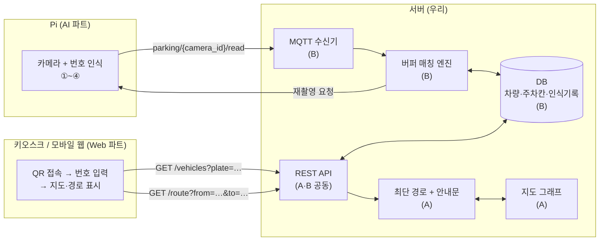
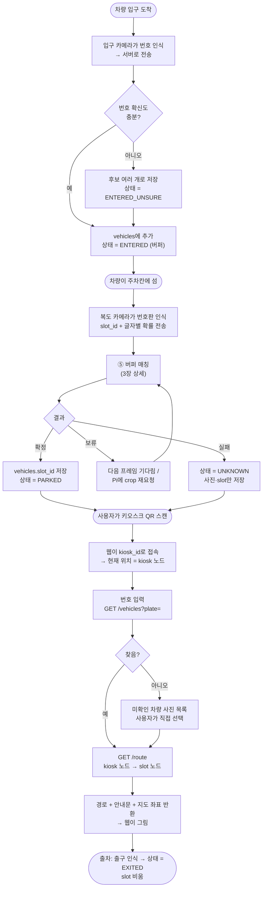
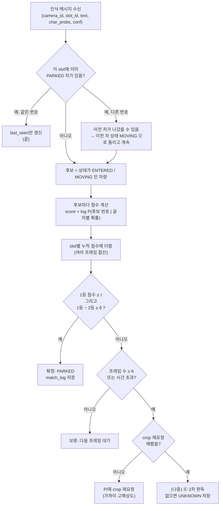
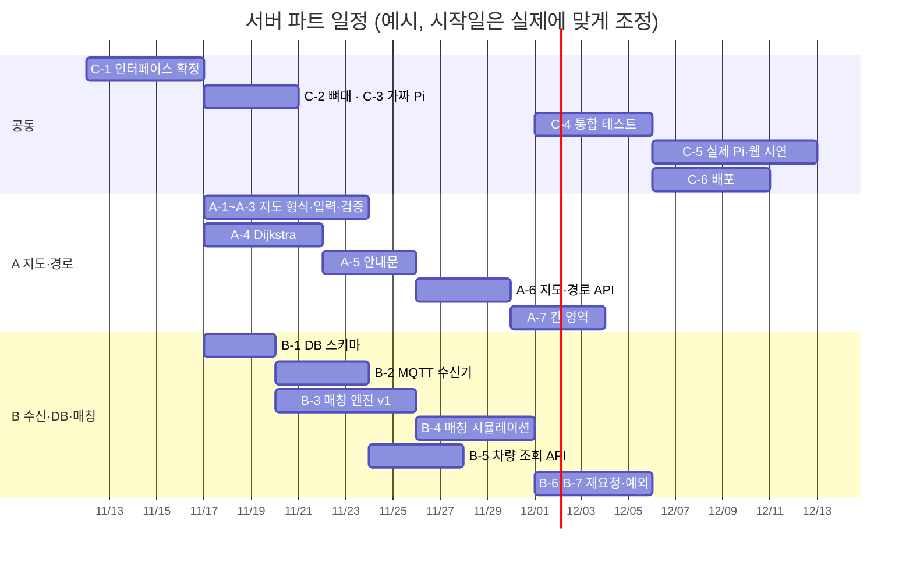
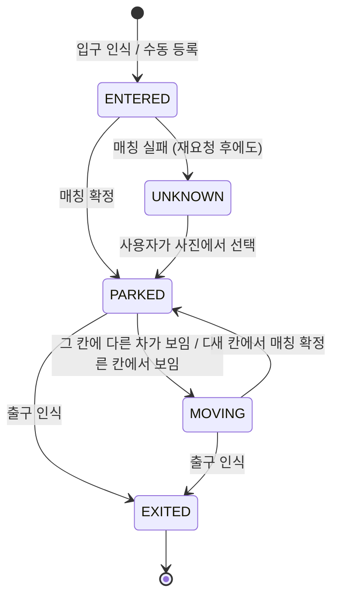

# SPASIBA 서버 파트 작업 계획 (2인)

> 작성: 2026-11-11 · 범위: Pi가 보낸 인식 결과를 받아 **차량 위치를 확정(DB 매칭)** 하고, 키오스크·앱 요청에 **지도와 최단 경로**를 돌려주는 서버
> 담당: 서버 2명 (아래에서 **A = 지도·경로**, **B = 수신·DB·매칭**)

---

## 0. 범위와 가정

**서버가 맡는 일**

1. Pi에서 인식 결과(번호 후보 + 글자별 확률 + 카메라/주차칸 ID)를 받는다.
2. 입차했지만 아직 주차 위치가 없는 차량 목록(버퍼)과 비교해 **어느 차가 어느 칸에 섰는지 확정**한다 (⑤ 버퍼 매칭).
3. 애매하면 Pi에 crop을 다시 요청하고, 그래도 안 되면 "미확인 차량"으로 저장한다 (⑥ 2차 판독은 나중 단계).
4. 주차장 지도를 그래프로 관리하고, 키오스크(QR) 위치 → 차 위치 **최단 경로**를 계산한다.
5. 키오스크·모바일 웹이 쓸 **API**를 제공한다.

**서버가 맡지 않는 일 (다른 팀원)**

- Pi에서 번호판 읽기 (①~④, AI 파트)
- 웹 화면 그리기 (Web 파트) — 서버는 화면에 필요한 데이터(JSON)만 준다
- 모형 주차장 제작

**가정** (팀에서 다르게 정하면 고친다 → 9장)

| 항목 | 가정 |
|---|---|
| 위치 단위 | **주차칸(slot) 단위**. 카메라 하나가 칸 몇 개를 보고, Pi가 `slot_id`를 같이 보낸다. 칸을 모르면 구역(zone) 단위로 떨어뜨린다 |
| 입차 정보 | 입구 카메라(같은 인식 모델)가 번호를 읽어 버퍼에 넣는다. 데모에서는 입구 화면에서 손으로 넣어도 된다 |
| 통신 | Pi → 서버: **MQTT** (Mosquitto). 웹 → 서버: **REST (HTTP/JSON)** |
| 스택 | Python **FastAPI** + **SQLite**(데모) → 필요하면 PostgreSQL. 경로는 직접 구현한 Dijkstra (`networkx`는 검증용) |
| 서버 위치 | 데모는 노트북/학교 서버 한 대. 클라우드 배포는 마지막 단계 |

---

## 1. 서버 전체 구조



---

## 2. 전체 동작 순서도 (차 한 대 기준)



---

## 3. 버퍼 매칭 순서도 (B 핵심)

Pi 한 번 전송 = "이 칸(slot)에서 이런 번호가 이 확률로 보였다"



### 3.1 점수 계산 (단계별로 키운다)

| 버전 | 방법 | 장점 | 한계 |
|---|---|---|---|
| **v1** (먼저) | Pi가 보낸 **글자별 상위 3개 확률**로 후보 번호를 한 글자씩 대조. 없는 글자는 작은 값(예: 1e-4). 글자 수가 다르면 편집 거리 기반 벌점 | 구현이 쉬움, 지금 Pi 출력 그대로 사용 | 글자가 하나 빠지거나 더해지면 약함 |
| v2 | Pi가 **CTC 전체 확률표(T×C)** 를 보내고, 서버가 **CTC forward**로 `P(후보 | 확률표)` 정확히 계산 | 길이 차이·연속 글자도 정확 | 메시지가 커짐 (fp16 약 10KB, MQTT로 충분) |

- 지역명(`서울`, `경기` …)은 토큰 1개 = 글자 1개로 센다 (AI 파트와 같은 규칙).
- τ, δ, K 는 **시뮬레이션으로 정한다** (5장 B-4).

### 3.2 왜 버퍼 매칭이 필요한가 (발표용 한 줄)

> 번호 하나를 처음부터 다 맞히는 대신, "지금 들어와 있는 차 N대 중 누구인가"를 고르는 문제로 바꾼다. 글자 하나를 틀려도 후보 중에서는 맞힐 수 있다.

---

## 4. 먼저 정해야 할 인터페이스 (1주차, A·B 공동)

두 사람이 따로 개발해도 마지막에 붙도록 **형식부터 고정**한다. AI 파트·Web 파트와도 이 문서로 합의한다.

### 4.1 Pi → 서버 (MQTT)

| 토픽 | 방향 | 내용 |
|---|---|---|
| `parking/{camera_id}/read` | Pi → 서버 | 인식 결과 (아래) |
| `parking/{camera_id}/request` | 서버 → Pi | crop 재요청 `{ "slot_id": "B2-A-03", "reason": "ambiguous" }` |
| `parking/{camera_id}/crop` | Pi → 서버 | 재요청 응답 (crop JPEG base64 + 인식 결과) |
| `parking/{camera_id}/status` | Pi → 서버 | 살아있음 신호 (30초마다) |

```json
{
  "camera_id": "CAM_B2_A",
  "slot_id": "B2-A-03",
  "timestamp": "2026-11-11T14:03:21+09:00",
  "frame_id": 1532,
  "text": "12가3456",
  "conf": 0.82,
  "char_probs": [[["1",0.99],["7",0.01]], [["2",0.97],["7",0.02]], [["가",0.91],["거",0.06]], ...],
  "box": [412, 288, 530, 322]
}
```

- `slot_id`를 Pi가 모르면 `null` + `box`를 보내고, 서버가 카메라별 칸 영역표로 바꾼다 (A가 지도 데이터에 칸 영역을 같이 관리).

### 4.2 웹 → 서버 (REST)

| 메서드 | 경로 | 응답 | 담당 |
|---|---|---|---|
| GET | `/map?floor=B2` | 노드·간선·칸 좌표 (지도 그리기용) | A |
| GET | `/kiosks/{kiosk_id}` | 키오스크 위치 노드, 층 | A |
| GET | `/vehicles?plate=12가3456` | 상태, slot_id, 최근 인식 시각 (부분 일치 후보 최대 5개) | B |
| GET | `/vehicles/unknown?floor=B2` | 미확인 차량 사진·slot 목록 | B |
| GET | `/route?from=KIOSK_A&to=B2-A-03` | 노드 경로, 총 거리, 안내문 목록, 지도 좌표 | A |
| POST | `/vehicles/entry` | (데모용) 입차 수동 등록 | B |
| POST | `/vehicles/{plate}/confirm` | 사용자가 미확인 사진에서 "내 차" 선택 | B |
| GET | `/admin/slots` | 전체 칸 현황 (관리·시연 화면) | B |

### 4.3 DB 테이블

| 테이블 | 주요 컬럼 | 담당 |
|---|---|---|
| `vehicles` | `plate` (PK, 지역명 포함 전체 문자열), `state` (ENTERED / MOVING / PARKED / UNKNOWN / EXITED), `slot_id`, `entered_at`, `parked_at`, `last_seen` | B |
| `reads` | `id`, `camera_id`, `slot_id`, `timestamp`, `text`, `conf`, `char_probs`(JSON), `crop_path` | B |
| `match_log` | `slot_id`, `plate`, `score`, `margin`, `n_frames`, `decision`, `decided_at` | B |
| `slots` | `slot_id`, `floor`, `zone`, `node_id`, `camera_id`, `polygon`(카메라 화면 속 칸 영역) | A (B가 읽음) |
| `nodes` / `edges` | `node_id`, `floor`, `x`, `y`, `type`(kiosk / junction / slot / elevator) · `from`, `to`, `length_m` | A |
| `kiosks` | `kiosk_id`, `node_id`, `floor`, `name` | A |

- 지도 데이터(`nodes`, `edges`, `slots`, `kiosks`)는 **JSON 파일 하나로 관리**하고 서버 시작 시 읽는다 (`map/b2.json`). 모형이 바뀌면 파일만 고친다.
- 번호판은 개인정보이므로 crop 이미지는 저장 기간을 정하고(예: 출차 후 삭제), 공개 저장소에 올리지 않는다.

---

## 5. 해야 할 일 전체 표

우선순위: **P0** = 데모에 꼭 필요 · **P1** = 있으면 좋음 · **P2** = 시간 남으면

### 공동 (A·B)

| ID | 작업 | 내용 | 산출물 | 선행 | 우선 |
|---|---|---|---|---|---|
| C-1 | 인터페이스 확정 | 4장 MQTT 메시지·REST·DB 형식을 AI·Web 파트와 합의 | `docs/server_interface.md` | - | P0 |
| C-2 | 저장소 뼈대 | `server/` 폴더, FastAPI 앱, 설정 파일, 테스트 폴더, 실행 스크립트 | 실행되는 빈 서버 | C-1 | P0 |
| C-3 | 가짜 Pi | 정해진 시나리오대로 MQTT 메시지를 쏘는 스크립트 (Pi 없이 개발) | `tools/fake_pi.py` | C-1 | P0 |
| C-4 | 통합 테스트 | 입차 → 주차 → 검색 → 경로까지 한 번에 도는 시나리오 테스트 | 테스트 통과 기록 | A·B 각 P0 | P0 |
| C-5 | 실제 Pi·웹 연결 | 모형 주차장에서 Pi 카메라 + 키오스크 웹으로 시연 | 시연 영상 | C-4 | P0 |
| C-6 | 배포 | 클라우드(또는 학교 서버)에 서버·MQTT 브로커 올리기 | 접속 주소 | C-4 | P1 |

### A — 지도·최단 경로

| ID | 작업 | 내용 | 산출물 | 선행 | 우선 |
|---|---|---|---|---|---|
| A-1 | 지도 데이터 형식 | 노드(좌표·종류)·간선(거리)·칸·키오스크·카메라를 담는 JSON 형식 정의 | `map/schema.md` | C-1 | P0 |
| A-2 | 모형 주차장 지도 입력 | 실제 우드락 모형을 재서 노드·간선 입력 (칸마다 접근 노드 지정) | `map/b2.json` | A-1, 모형 도면 | P0 |
| A-3 | 지도 검증 | 끊긴 노드, 칸에 연결 안 된 노드, 음수 거리 검사 + 그림으로 확인 | `tools/check_map.py`, 지도 그림 | A-2 | P0 |
| A-4 | 최단 경로 | Dijkstra 직접 구현, `networkx` 결과와 비교 테스트 | `server/route.py` + 테스트 | A-1 | P0 |
| A-5 | 안내문 생성 | 경로의 꺾이는 지점에서 좌/우/직진 판단(벡터 외적), "20m 직진 후 우회전" 문장 | 안내문 목록 | A-4 | P0 |
| A-6 | 지도·경로 API | `/map`, `/kiosks/{id}`, `/route` | API + 응답 예시 | A-4, C-2 | P0 |
| A-7 | 카메라 화면 칸 영역 | 카메라별로 화면 속 칸 영역(polygon) 기록 → Pi가 `slot_id`를 모를 때 box로 칸 결정 | `slots.polygon` + 변환 함수 | A-2 | P1 |
| A-8 | 여러 층 | 엘리베이터·경사로 노드로 층 연결, 층 바뀌는 안내문 | 2층 지도 | A-4 | P2 |
| A-9 | 통행 제약 | 일방통행 간선(방향 그래프), 보행자 통로 우선 가중치 | 옵션 | A-4 | P2 |

### B — 수신·DB·버퍼 매칭

| ID | 작업 | 내용 | 산출물 | 선행 | 우선 |
|---|---|---|---|---|---|
| B-1 | DB 스키마 | 4.3 테이블 생성, 상태 전이 규칙 (ENTERED → PARKED 등) 코드로 고정 | `server/db.py`, 마이그레이션 | C-1 | P0 |
| B-2 | MQTT 수신기 | 브로커 구독 → 메시지 검증 → `reads` 저장 → 매칭 엔진 호출. 잘못된 메시지는 로그만 | `server/mqtt_listener.py` | B-1, C-3 | P0 |
| B-3 | 매칭 엔진 v1 | 3장 순서도 구현: 후보 고르기, 글자별 확률 점수, 프레임 누적, τ·δ·K 판정 | `server/matching.py` + 테스트 | B-1 | P0 |
| B-4 | 매칭 시뮬레이션 | AI 파트의 **테스트 세트 확률표**로 가짜 버퍼 N대(10 / 50 / 200)를 만들어 정확도 측정 → τ·δ·K 결정 | 결과 표, 발표용 그래프 | B-3, AI 파트 확률표 | P0 |
| B-5 | 차량 조회 API | `/vehicles`, `/vehicles/unknown`, `/vehicles/entry`, `/vehicles/{plate}/confirm`, `/admin/slots` | API + 응답 예시 | B-1, C-2 | P0 |
| B-6 | 재요청 흐름 | 보류가 K 프레임 넘으면 `parking/{camera}/request` 발행, 응답 crop 처리, 타임아웃 시 UNKNOWN | 재요청 동작 | B-3 | P1 |
| B-7 | 예외 처리 | 같은 칸에 다른 차(이전 차 이동), 같은 차가 두 칸에서 보임, 입차 기록 없는 차 | 테스트 케이스 | B-3 | P1 |
| B-8 | 매칭 엔진 v2 | CTC 전체 확률표 + forward 점수 (AI 파트가 확률표 전송을 지원하면) | v1 대비 정확도 비교 | B-4 | P2 |
| B-9 | ⑥ 2차 판독 연동 | AI Hub CRAFT+STR을 서버에서 돌려 UNKNOWN 직전에 한 번 더 읽기 | 연동 코드 | B-6 | P2 |
| B-10 | 개인정보 정리 | crop 보관 기간, 출차 후 삭제 작업 | 정리 스크립트 | B-1 | P1 |

---

## 6. 2명 분담 방법

### 6.1 나누는 기준

**"데이터가 들어오는 쪽(B)"과 "사용자에게 나가는 쪽(A)"** 으로 자른다. 두 쪽이 만나는 곳은 DB의 `vehicles.slot_id`와 `slots.node_id` 두 컬럼뿐이라 서로 기다릴 일이 적다.

| | A — 지도·경로 | B — 수신·DB·매칭 |
|---|---|---|
| 한 줄 | "칸까지 어떻게 가나" | "이 칸에 선 차가 누구인가" |
| 핵심 기술 | 그래프, Dijkstra, 좌표 계산, REST | MQTT, DB 설계, 확률 점수, 시뮬레이션 |
| 주로 맞추는 팀 | Web 파트, 모형 제작 | AI 파트(Pi 출력 형식) |
| 혼자 테스트하는 방법 | 지도 JSON + 단위 테스트 | 가짜 Pi(C-3) + 시뮬레이션(B-4) |
| 발표에서 보여줄 것 | 경로 그림, 안내문, 계산 시간 | 버퍼 크기별 매칭 정확도 그래프 |

**추천 배정**: OCR 확률표 형식과 CTC를 이미 아는 사람(수인)이 **B**를 맡으면 AI 파트와 바로 맞출 수 있다. 친구가 **A**를 맡고 Web 파트와 화면·API를 맞춘다. 반대로 해도 되지만, B의 매칭 점수는 AI 출력 형식에 많이 기대므로 그 형식을 아는 사람이 맡는 게 빠르다.

### 6.2 함께 하는 것

- **C-1 인터페이스 회의**: 첫 주에 둘이 같이 4장을 확정하고 AI·Web 파트에 공유
- **코드 리뷰**: 서로의 PR을 한 번씩 보고 merge (상대 코드 구조를 알아야 통합 때 덜 막힘)
- **통합 테스트(C-4)와 시연(C-5)**: 같이
- 일주일에 한 번 15분: 진행 상황, 막힌 것, 인터페이스 변경 여부

### 6.3 겹치거나 헷갈리는 경계

| 항목 | 누가 | 이유 |
|---|---|---|
| `slots` 테이블 | A가 만들고 관리, B는 읽기만 | 칸 = 지도의 일부 |
| 카메라 → 칸 매핑 | A (지도 JSON에 포함) | 모형을 재는 사람이 같이 기록 |
| `/vehicles` 결과에 경로까지 붙이기 | 붙이지 않음. 웹이 `/vehicles` → `/route` 두 번 호출 | 두 사람 코드가 섞이지 않게 |
| 서버 뼈대·설정·배포 | 공동 (C-2, C-6) | 둘 다 써야 함 |
| 관리자 화면 `/admin/slots` | B | 차량 상태 데이터 |

### 6.4 Git 작업 방식

- 브랜치: `server/main`(통합) ← `server/map-route`(A), `server/matching`(B)
- 폴더: `server/route.py`, `server/map_*.py`, `map/` = A · `server/db.py`, `server/matching.py`, `server/mqtt_listener.py` = B · `server/app.py`, `tools/fake_pi.py` = 공동
- 인터페이스(4장)를 바꿀 때는 **문서 먼저 고치고** 상대에게 알린 뒤 코드 수정

---

## 7. 일정 (주 단위, 시작 주 = 1주차)



| 주차 | 목표 (이번 주 끝에 되어야 하는 것) |
|---|---|
| 1 | 인터페이스 문서 확정, 서버 뼈대 실행, 가짜 Pi가 메시지를 보냄 |
| 2 | A: 모형 지도 JSON + Dijkstra 테스트 통과 · B: DB + 수신기 + 매칭 v1 (가짜 Pi로 PARKED 확정) |
| 3 | A: 안내문 + `/route` API · B: 시뮬레이션으로 τ·δ·K 결정, `/vehicles` API |
| 4 | 통합 테스트: 가짜 Pi → 매칭 → 검색 → 경로가 한 번에 동작 |
| 5 | 실제 Pi·키오스크 웹 연결, 모형 주차장 시연 리허설, 예외 처리 |
| 6 | 배포, 발표 자료(경로 그림, 매칭 정확도 그래프), 시연 영상 |

> 실제 마감일을 알면 주차를 날짜로 바꾼다. 시간이 부족하면 **P0만** 남기고 A-7, B-6 이후는 뺀다.

---

## 8. 완료 기준과 평가

| 항목 | 기준 | 측정 |
|---|---|---|
| 매칭 정확도 | 버퍼 N = 10 / 50 / 200 에서 정답 차량을 고른 비율, 오확정률(틀린 차로 확정) | B-4 시뮬레이션. **발표 비교표**: OCR 1등만 / + 여러 프레임 / + 버퍼 매칭 |
| 확정까지 걸린 프레임 수 | 평균·최대 | B-4 |
| 경로 정확도 | 모든 (키오스크, 칸) 쌍에서 직접 구현 Dijkstra = `networkx` 결과 | A-4 테스트 |
| 경로 응답 시간 | 모형 지도에서 `/route` 50ms 이하 | A-6 |
| 전체 시나리오 | 입차 → 주차 → 검색 → 경로가 사람 손 없이 동작 | C-4, C-5 |

---

## 9. 팀에서 정해야 할 것 (첫 회의 안건)

| 질문 | 선택지 | 영향 |
|---|---|---|
| 위치 단위 | 주차칸(slot) / 구역(zone) | 칸 단위면 A-7(카메라 화면 칸 영역)이 필요. 구역 단위면 매칭 후보가 많아짐 |
| 입차 정보 출처 | 입구 카메라 인식 / 키오스크 수동 입력 / 둘 다 | 버퍼 후보가 어떻게 생기는지 |
| Pi가 `slot_id`를 아는가 | Pi가 계산 / 서버가 box로 계산 | 칸 영역표를 누가 관리하는지 |
| Pi 출력 | 글자별 상위 3개(지금) / CTC 전체 확률표 | 매칭 v1만 할지 v2까지 할지 |
| 서버 위치 | 노트북 / 학교 서버 / 클라우드(AWS 등) | 배포 작업량, 시연장 네트워크 |
| 웹 화면 담당 | Web 파트 / 서버 파트가 간단한 화면까지 | A의 작업량 |
| 미확인 차량 처리 | 사진 목록에서 사용자가 선택 / 관리자 확인 | B-5 API 범위 |

---

## 10. 참고: 상태 전이


